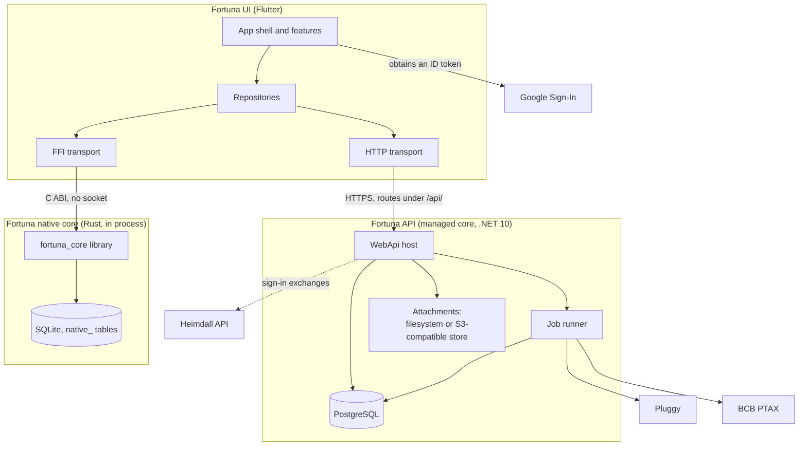
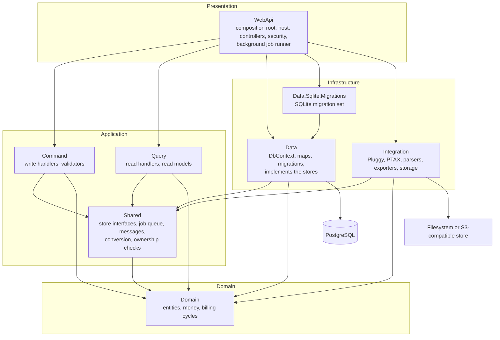
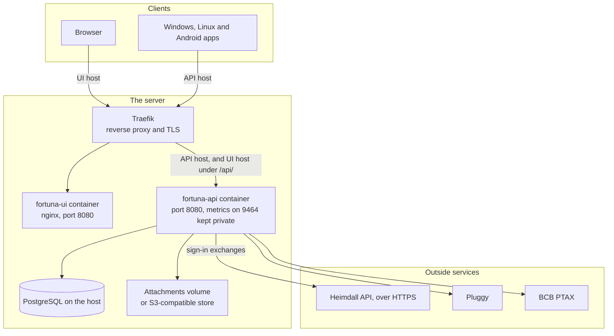
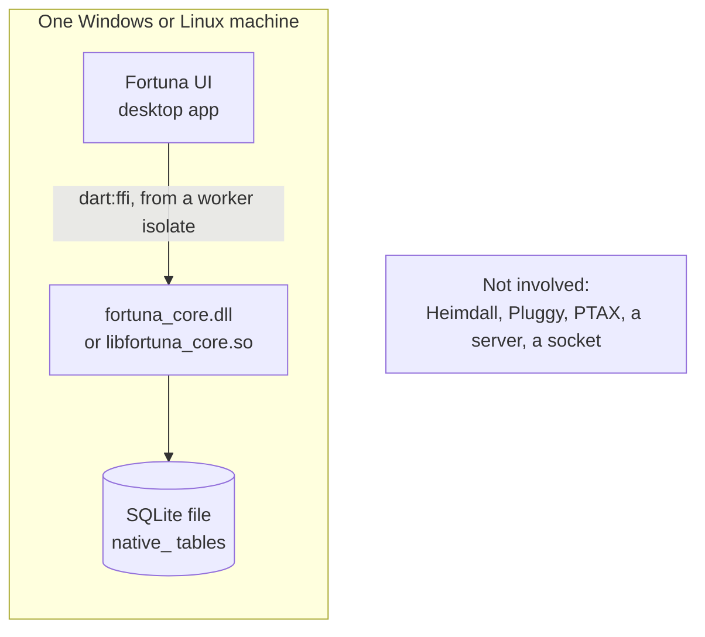
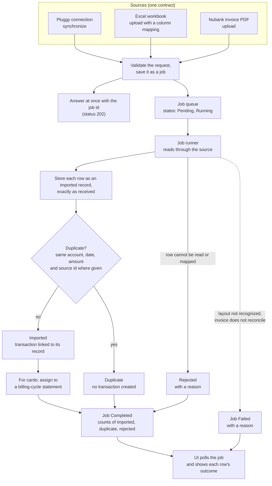
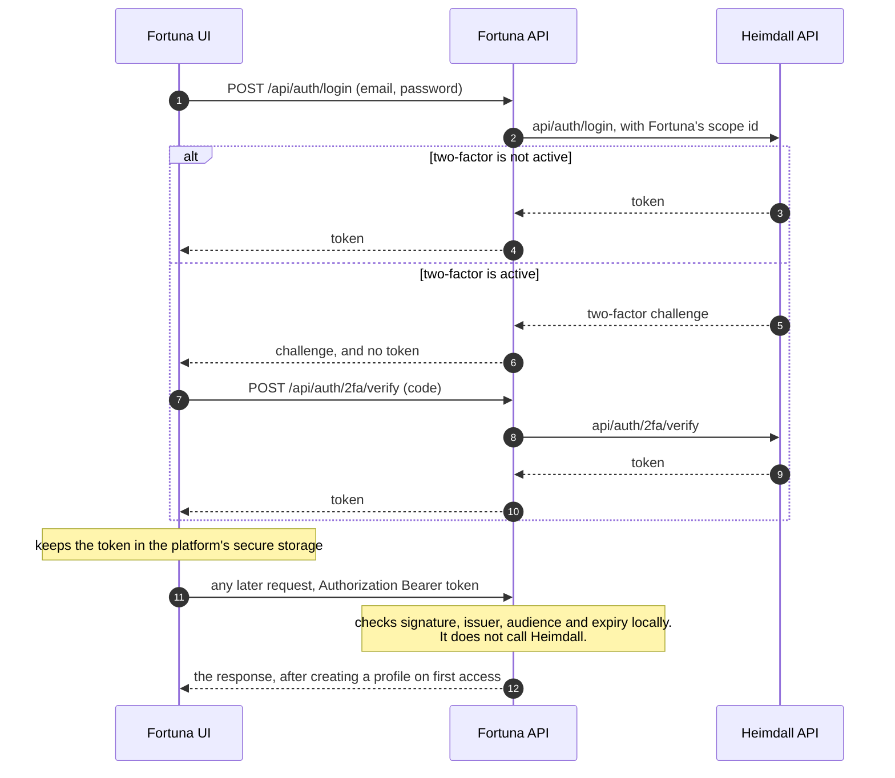
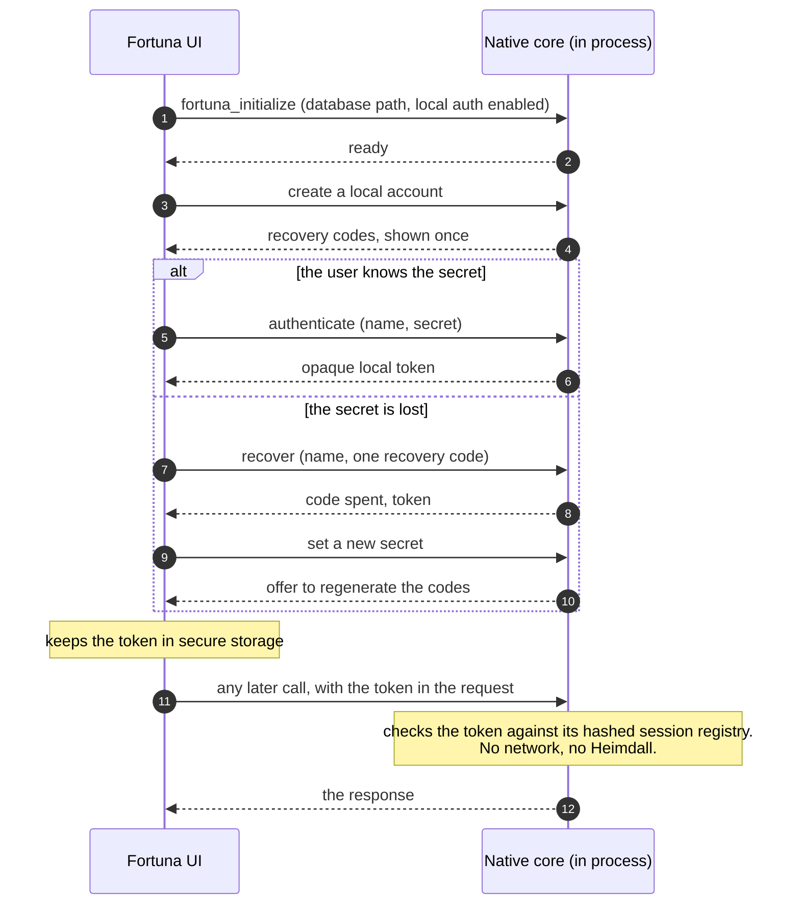
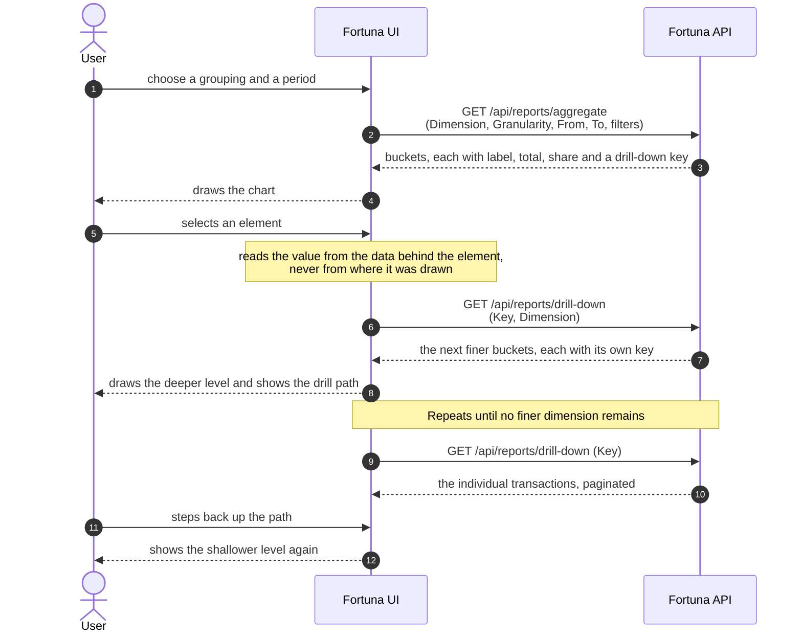

This page shows how the parts of Fortuna fit together. It has five views: the
components, the two deployment modes, the import pipeline, signing in through
Heimdall, and the drill-down from a chart to the transactions behind it. A list
of what desktop offline mode cannot do yet closes the page.

The terms used here (holdings, statements, projections, source contract,
PTAX) are explained on the [Concepts]() page, and
what Fortuna is and who it is for is on the [Overview]().
The counts and names below were checked on 2026-10-13 against the `develop`
branches of the two repositories.

## Components

Fortuna has three runnable parts.

- **The managed core** is the Fortuna API: an ASP.NET Core web API on .NET 10
  that owns the domain, the data and the integrations. Shared deployments store
  data in PostgreSQL.
- **The native core** is a Rust library inside the API repository. It offers the
  same operations through a C interface, so that a desktop app can call it in
  process with no server. It is described under [The native core](#the-native-core).
- **The UI** is one Flutter application for the web, Windows, Linux and Android.
  It computes no money and keeps no financial data: it asks the API (or the
  native core) for everything it shows.

Read the diagram from the top.

- A feature never knows how its data arrives. It talks to a repository, and each
  repository has one implementation per transport: HTTP, or FFI into the native
  core. The transport is chosen once, at build time.
- The API reaches Heimdall (the identity provider), Pluggy (open banking) and the
  Banco Central do Brasil's PTAX rates. Heimdall takes part in sign-in only; see
  [Signing in through Heimdall](#signing-in-through-heimdall). Pluggy and PTAX
  are called by background jobs.
- The UI talks to Google only to obtain a sign-in token, which it hands to the
  API ([UI-BR-20]()).
- The native core has no network connection to anything. It does not call
  Heimdall, Pluggy or PTAX.

### Inside the API

The API is a layered, domain-driven design, built to the same shape as the
[Heimdall API](https://github.com/artur-rios/heimdall-api) with one addition: an
`Integration` project for everything that talks to the outside. Handlers are
split into write (`Command`) and read (`Query`), dispatched through a mediator,
and return a `DataOutput` envelope that the controllers map to an HTTP status.

| Layer | Project | Holds |
| --- | --- | --- |
| Domain | `ArturRios.Fortuna.Domain` | Entities, money, billing cycles, invariants. |
| Application | `ArturRios.Fortuna.Command` | Write handlers and validators. |
| Application | `ArturRios.Fortuna.Query` | Read handlers and read models. |
| Application | `ArturRios.Fortuna.Shared` | The interfaces the handlers use to reach persistence (the stores, such as `IFinancialAccountStore`), the job queue, the messages, currency conversion and ownership checks. |
| Infrastructure | `ArturRios.Fortuna.Data` | The EF Core `AppDbContext`, entity maps, PostgreSQL migrations and seeding. It implements the store interfaces. |
| Infrastructure | `ArturRios.Fortuna.Data.Sqlite.Migrations` | The EF Core migration set for SQLite. |
| Infrastructure | `ArturRios.Fortuna.Integration` | Excel and Nubank PDF parsers, Pluggy gateways, the source registry, the PTAX rate client, the export renderer, attachment storage and the Heimdall gateway. |
| Presentation | `ArturRios.Fortuna.WebApi` | The ASP.NET Core host: controllers, security, OpenAPI, observability and the background job runner. |

The diagram follows the projects' references in the solution. The Operations &
Infrastructure Document draws this differently (handlers pointing straight at
`Data`, and the job runner under Infrastructure); the code is what is shown here.

- **`WebApi` is the composition root.** It is the only project that references
  `Data` and `Integration`, and it registers their implementations of the `Shared` interfaces at
  start-up.
- **Handlers reach persistence through interfaces.** `Command` and `Query` know
  only `Domain` and `Shared`. They call the store interfaces in `Shared`, and
  `Data` implements them.
- **`Integration` does not reference `Data`**, on purpose. A parser or an
  aggregator client returns domain-shaped results and hands them to a command
  handler, which is the code that saves them. Keeping that arrow out is what stops
  a statement parser from gaining the ability to write a row.

Background work runs as a hosted service in `WebApi` that reads a bounded
in-memory queue (the queue itself is in `Shared`), with a durable job table behind
it. Jobs left pending or running when the process stops are queued again at
start-up. Imports, synchronizations and exports all use it.

### The native core

The native core is a Rust crate, `fortuna-native-core` 0.1.0 (edition 2024, Rust
1.85 or later), built as a dynamic library. It produces `fortuna_core.dll` on
Windows and `libfortuna_core.so` on Linux, together with a C header
generated by `cbindgen`.

It exists because compiling the .NET code ahead of time with NativeAOT was tried
first, and the feasibility probe showed that EF Core 10 could not produce the
library reliably. The native core was written in Rust instead. It does not link the .NET assemblies and does not use EF
migrations: it is a second implementation of the same contract.

- **It has its own storage.** Its SQLite tables are all prefixed `native_`, and it
  applies its own migrations when it starts. The managed API can also run on
  SQLite, but the two SQLite schemas are separate and are not interchangeable
  files.
- **The OpenAPI document is a build input.** The build generates the table of
  operations and the C header from the API's `docs/openapi/fortuna.json`, so the
  C interface follows the HTTP contract.
- **The C interface has 115 generated route functions.** Each is named after its
  HTTP route. For example, `fortuna_api_transactions_by_id_put` mirrors
  `PUT /api/transactions/{id}`. Six more functions cover the library's lifecycle and its memory:
  `fortuna_initialize`, `fortuna_shutdown`, `fortuna_version`, `fortuna_health`,
  `fortuna_capabilities` and `fortuna_string_free`. The header also holds two
  route-style functions that the native README lists separately,
  `fortuna_api_local_accounts_authenticate` and `fortuna_api_accounts_get_by_id`.
- **Calls use the HTTP envelope.** Every function except `fortuna_string_free`
  returns an HTTP-compatible status code and writes JSON to an output pointer, in
  the same `data`, `messages`, `errors`, `timestamp`, `success` envelope the API
  uses. The caller must pass each response to `fortuna_string_free` exactly once.
  No Rust panic crosses the boundary, and calls are safe from background threads.
- **Not everything is implemented.** Of the 115 route functions, 26 are exported
  but answer `501`, and 30 of the API's 145 operations are not exported at all.
  [What offline mode does not support yet](#what-offline-mode-does-not-support-yet)
  lists them. The function `fortuna_capabilities` reports the split, so a client
  can ask before it calls.

### How the UI reaches the core

The UI's features depend on repository interfaces. Under them sit two
implementations of each repository.

- **HTTP** uses `dio` and a client generated from the API's OpenAPI document.
- **FFI** uses `dart:ffi` bindings generated by `ffigen` from the C header, which
  the UI vendors verbatim from the API repository. CI compares the two copies,
  so a difference fails the build instead of surfacing when the app runs.

Both carry the same JSON bodies and envelope, so the same generated models serve
both. FFI calls run on a worker isolate, so a slow database call never blocks the
interface. The library is looked up beside the executable first and then under
`native/windows` or `native/linux`; whether the library loads, not whether the
file exists, decides if offline mode is offered at all. The UI also checks the
API's contract version, the `v1` in `info.version` of the OpenAPI document, and
treats a mismatch as an incompatible server.

## Deployment modes

Fortuna runs in two shapes, and what differs is where the work happens.

### Shared instance

A shared instance is the API, the web UI and a PostgreSQL database, behind a
reverse proxy. It serves several users, each isolated from the others
([API-BR-01]()). The
shape below is the one the project's own VPS uses for its development,
homologation and production environments, deployed with
[yggdrasil](https://github.com/artur-rios/yggdrasil). Running it yourself, on a
machine you control, is the "self-hosted" mode.

- The browser reaches the API on its own origin, under `/api/` on the UI's host.
  This matters because the API has no CORS support. The desktop and Android apps
  use the API's own host.
- PostgreSQL is not part of the API's compose file. Each machine already runs one
  instance, shared by services, and each service owns its own database in it.
- The API's metrics are served on a separate private port (9464 by default), which
  the compose file never publishes.
- The API reaches Heimdall over HTTPS, because the configured Heimdall address
  must be HTTPS. Each environment therefore uses its own Heimdall's public host.

On a developer's machine the same compose file runs the API alone, without
Traefik, on `http://localhost:8083`. The Installation and Operations sections
cover the commands and the settings.

### Desktop offline

Desktop offline mode puts everything on one machine. The Flutter app loads the
native core as a library and calls it directly, and the core keeps its data in a
SQLite file. There is no server, no network, no Heimdall, no Pluggy and no
rate source.

- Offline mode is offered only on Windows and Linux, and only where the core
  library actually loads. It is never offered on the web or on Android
  ([UI-BR-25]()).
- The database path is set at build time with `FORTUNA_DB_PATH`. It defaults to
  beside the executable, so that a portable copy of the folder keeps its data.
- The user signs in with a local account that Fortuna owns, because there is no
  network to reach Heimdall over. See
  [Offline: the local account](#offline-the-local-account).

The API can also run on SQLite on its own, as an alternative local deployment,
by setting `FORTUNA_DATA_DATABASETYPE` to `SQLite`. That is still the .NET API
behind HTTP, not the native core.

## The import pipeline

An import brings records in from outside Fortuna. Three sources run as
background jobs today: a Pluggy connection, an Excel workbook and a Nubank credit
card invoice PDF. They all implement one source contract, so a new source can be
added without changing the others or anything that reads imported data. What the
sources are and the rules around duplicates are in
[Imports]().

What the diagram shows:

1. **The request is accepted, not performed.** The API validates the file, the
   mapping and the target, saves the request as a job and answers with the job's
   identifier, without doing the work on the request thread. The route that
   accepts a file import answers `202`.
2. **A job runner does the work**, so a long import never blocks the API. A job
   moves from Pending to Running and then to Completed or Failed.
3. **Every row is stored as read.** The raw record is kept and is never edited
   ([API-BR-24]()). A transaction made from
   it links back to the record, which is what [reconciliation]()
   later relies on.
4. **Each row has its own outcome**: imported, duplicate, or rejected with a
   reason. One bad row does not stop the rows around it
   ([API-BR-27]()).
5. **Some failures stop the whole job.** A PDF whose layout is not recognized, or
   an invoice whose lines do not add up to its stated amount due, fails the job
   and imports nothing. A failed Excel or Pluggy import commits none of its rows.
6. **The UI only watches.** It uploads the file whole, then reads the job and
   its per-row records from the API and shows each outcome as reported
   ([UI-BR-28 and UI-BR-31]()).

A job that failed can be retried. The retry treats whatever the earlier attempt
already imported as a duplicate, so nothing is imported twice. In desktop offline
mode, file imports and retries are not available.

## Signing in through Heimdall

In connected mode, Heimdall owns identity: accounts, passwords, two-factor
authentication, email verification and recovery. Fortuna is registered with
Heimdall as a **scope**. The UI never talks to Heimdall. It signs in through
Fortuna's own `/api/auth/*` routes, and Fortuna forwards each exchange to
Heimdall with its configured scope identifier attached. The caller cannot choose
a different scope.

What Fortuna keeps for itself is the token check. After sign-in, every request
carries the token Heimdall issued, and Fortuna validates it locally against the
shared signing configuration, without calling Heimdall.

- **Fortuna stores no password.** A password exists in Fortuna only in transit,
  on its way to Heimdall ([API-BR-35]()).
- **Google sign-in** follows the same path. The UI obtains a Google ID token,
  posts it to `/api/auth/google`, and Fortuna exchanges it through Heimdall.
- **A profile is created on first access.** The first authenticated request from
  a new subject makes Fortuna create the local profile that the user's records
  hang from, with no administrator involved.
- **Two-factor works through the API, but the UI screen is unfinished.** Fortuna
  forwards the challenge and its verification, as drawn. The UI's two-factor
  screen (UC-04) is still a placeholder, so a user with two-factor active cannot
  complete sign-in in the interface yet. See
  [Overview]().
- **Rate limits and failures.** The anonymous sign-in routes allow ten attempts
  per minute per source address. If Heimdall is down, Fortuna answers a sanitized
  `503` and gives no upstream detail. A credential failure is one `401` with one
  message, so it does not reveal whether an account exists.
- **Revocation is not instant.** Because tokens are validated without asking
  Heimdall, a token revoked at Heimdall stays acceptable to Fortuna until it
  expires. The requirements therefore call for a configurable token lifetime that
  is short by default.

To set up the identity side, see Heimdall's own documentation:
[Integrating with Heimdall](https://artur-rios.github.io/heimdall-docs/docs/integrating/)
for what a client system needs, and
[Heimdall architecture](https://artur-rios.github.io/heimdall-docs/docs/architecture/)
for how Heimdall is built.

### Offline: the local account

Offline, there is no Heimdall to reach, so a desktop installation has its own
identity. This is the one case in which Fortuna manages a user itself. The local
account lives in the native core and never leaves the machine
([API-BR-36 and API-BR-37]()).

- The token is opaque. The core stores only its SHA-256 hash, the token expires
  after the configured lifetime, and every token is invalidated when the core
  shuts down. A stored session that the core cannot verify offline is discarded.
- A local account has no password reset and no email recovery. A recovery code is
  the only way back into the account if the secret is lost
  ([UC-08, API-BR-36]()).
  The codes are issued once, when the account is created, and each can be used
  once. Using one spends it, the UI says how many remain, and after the user sets a
  new secret it offers to regenerate the set. If every code is spent, the account
  cannot be recovered.
- The connected sign-up flow does not apply offline. A local account is made
  through its own creation path, shown above.

## Chart drill-down

A chart in Fortuna is not a picture of numbers. Every element carries a key that
stands for the records behind it, and selecting an element asks the API for the
next, finer level. The last level is the individual transactions, so any figure on
a chart can be explained down to its source
([API-BR-34 and UI-BR-13]()).

- **The API does the arithmetic.** The aggregation excludes soft-deleted records
  and transfers, totals each bucket as an exact decimal and, when several
  currencies are involved, converts to the display currency and reports the rates
  it used. The UI only draws the result
  ([UI-BR-02]()).
- **Each level is a new request.** The UI never subdivides a bucket it already
  holds ([UI-BR-14]()).
  It keeps a drill path, which is what lets the user step back and see what the
  figures on screen are bounded by. Stepping back from the first level returns the
  chart to its unfiltered state.
- **A key is short-lived and tied to the user.** An expired or malformed key is
  refused with `400`, and the aggregation is requested again. A key that resolves
  to another user's records answers `404`, as if it did not exist. The key's
  lifetime and the longest date range are operator settings,
  `FORTUNA_REPORT_KEY_TTL_MINUTES` and `FORTUNA_REPORT_MAX_RANGE_DAYS`.
- **If records change in between**, the drill-down reflects the current data and
  the response says that its totals may differ from the chart's.
- **A remainder group is drillable too.** When a chart has too many elements to
  read, the UI groups the smallest into a remainder, and selecting it expands it
  like any other element.

Charts are not available in desktop offline mode, because the native core does not
compute reports. See the next section.

## What offline mode does not support yet

The native core does not implement everything the API does. Rather than offer
these features and then refuse, the UI shows them as **Not available offline**,
with the core's reason. The UI reads the core's list of unavailable operations
once, when offline mode starts. If a call still reaches the core and gets `501`,
the UI shows the reason and offers no retry, because it would fail the same way
again.

The UI README names these features. The reason for each is the core's own, from
the [native core README](https://github.com/artur-rios/fortuna-api/blob/develop/native/README.md).

| Feature | Why it is not available offline |
| --- | --- |
| File imports | No workbook or PDF statement parser exists natively, so an import would not be processed. |
| Data-set exports | No data-set export renderer exists natively. The personal data archive is available. |
| Charts, net position and projections | Reports and projections are not computed natively. |
| Transfers | Paired transaction legs, conversion and the lifecycle cascade are not implemented. |
| Installment purchases | Splitting a purchase into installments assigned to billing cycles is not implemented. |
| Card statements | Charges are not assigned to billing cycles natively. |
| Budget consumption | Consumption is not computed natively. |
| Goal progress | Progress is not computed natively. |
| Reconciliation | It needs imported records, which the native core does not create. |

The core's list also covers three operations that the UI README does not name.

- **Retrying an import job** has the same reason as file imports. The UI's own
  list of offline gaps includes it, so it is shown as not available offline.
- **Materializing recurring transactions** is not available because occurrences
  are not materialized natively. The UI lists this too.
- **`POST /api/reports/table`**, the generic table query, also answers `501`
  ("reports are not computed natively"). The UI has a generated client for it but
  no screen calls it, and it keeps no entry for it in its list of offline gaps, so
  a reader sees nothing different. The transactions spreadsheet loads through
  `GET /api/transactions`, which the core implements.

A few more points complete the picture.

- **Some things are absent on purpose** because they depend on the network or on a
  host: connected identity, administrator erasure of a user, Pluggy connections,
  remote exchange-rate synchronization, the HTTP health routes and hosted
  consent. These are not exported at all.
- **The personal data export works offline.** The core builds the ZIP archive
  itself.
- **The remaining work is tracked.** The API's open issues
  [#200](https://github.com/artur-rios/fortuna-api/issues/200) (implement the
  operations that now return `501` offline) and
  [#201](https://github.com/artur-rios/fortuna-api/issues/201) (generic records
  are stored without validation) follow the native core's remaining work.
- **A short version** of this list is on the
  [Overview]() page.

The machine-readable list is the `fortuna_capabilities` function: it reports the
implemented operations under `operations`, the exported-but-unimplemented ones
with their reason under `notImplemented`, and the ones that are not exported under
`unavailable`.

## Sources

This page is written from the API's
[Technology Stack](https://github.com/artur-rios/fortuna-api/blob/develop/docs/requirements/Technology%20Stack%20Document.md),
[Operations & Infrastructure](https://github.com/artur-rios/fortuna-api/blob/develop/docs/requirements/Operations%20%26%20Infrastructure%20Document.md),
[System Requirements](https://github.com/artur-rios/fortuna-api/blob/develop/docs/requirements/System%20Requirements%20Document.md)
and [Use Case Specification](https://github.com/artur-rios/fortuna-api/blob/develop/docs/requirements/Use%20Case%20Specification%20Document.md)
documents, the [native core README](https://github.com/artur-rios/fortuna-api/blob/develop/native/README.md)
and its [C header](https://github.com/artur-rios/fortuna-api/blob/develop/native/fortuna-core/include/fortuna_core.h),
and the UI's
[README](https://github.com/artur-rios/fortuna-ui/blob/develop/README.md),
[native README](https://github.com/artur-rios/fortuna-ui/blob/develop/native/README.md)
and
[Operations & Infrastructure](https://github.com/artur-rios/fortuna-ui/blob/develop/docs/requirements/Operations%20%26%20Infrastructure%20Document.md)
and
[Technology Stack](https://github.com/artur-rios/fortuna-ui/blob/develop/docs/requirements/Technology%20Stack%20Document.md)
documents, checked against the code where they differ. One difference worth
knowing: the Vision Document draws the client signing in with Heimdall directly,
while the use cases and the code route every sign-in exchange through Fortuna's
`/api/auth/*`. This page follows the code.
