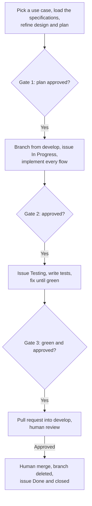

Both Fortuna repositories are built the same way, by the same process the
author's other projects use, so a contributor learns it once. This page is the
short form. The authoritative texts are each repository's **Development
Workflow Document** and **Testing Specification Document**, linked from the
[Repositories]() page and from each section
below, and each repository's `CONTRIBUTING.md`
([API](https://github.com/artur-rios/fortuna-api/blob/develop/CONTRIBUTING.md),
[UI](https://github.com/artur-rios/fortuna-ui/blob/develop/CONTRIBUTING.md)).
Where the API and the UI differ, the sections say so.

> **One use case = one branch = one issue = one pull request.**

A *use case* here is one of the numbered `UC-xx` items in a Use Case
Specification Document. The API's start at UC-01 and include UC-75 (health
check), which is defined in its Operations & Infrastructure Document; the UI's
have their own numbering, as the [User guide]()
shows. Use cases are never batched into a shared branch or a shared pull request.

## How a use case is delivered



At every gate a "no" sends the work back to the step before it, and a human
reviewer who asks for changes sends it back to testing.

1. **Load the specifications and refine the plan.** Before any code, read the
   use case with every alternative flow (`AF-xx`), the requirements traced to it,
   and the Technology Stack Document, then write a design and a test-first
   implementation plan. For a UI use case the API endpoints it calls are also
   read, in the API's own documents, rather than guessed at.
2. **Branch from `develop`**, an up-to-date copy of it:

   ```bash
   git switch develop
   git pull
   git switch -c feature/uc-30-record-a-transaction
   ```

   The pattern is `feature/uc-##-use-case-name`: the zero-padded use case number,
   then its name in lower-case kebab-case. In the API, UC-11 is
   `feature/uc-11-create-a-financial-account`. In the UI, UC-19 is
   `feature/uc-19-record-a-transaction`. The two repositories number their use
   cases separately, so the same number is a different use case in each.
3. **Move the issue to In Progress** as soon as the branch exists. This is the
   only status change made without asking.
4. **Implement** the main flow and every alternative flow. All commits for the use
   case go on its branch.
5. **Move the issue to Testing** once the implementation is approved.
6. **Test until green** (see [Testing](#testing)).
7. **Open a pull request** from the feature branch into `develop`, referencing
   the use case and its issue (for example `Closes #<issue-number>`) so the merge
   closes it.
8. **A human reviews and merges.** Requested changes are made on the same branch,
   returning to the testing step whenever code changes. The feature branch is
   deleted after the merge.
9. **Move the issue to Done and close it.** A merge with a `Closes` reference
   closes it automatically; the board should still show it in Done.

### Issue status

Each use case is an issue on the repository's GitHub project board
([API](https://github.com/users/artur-rios/projects/12),
[UI](https://github.com/users/artur-rios/projects/14)). Its `Status` field moves
forward only, in order:

| Order | Status | Set when |
| --- | --- | --- |
| 1 | **Tod&#111;** | The use case has not been started (the default). |
| 2 | **In Progress** | A branch has been created and implementation has begun. |
| 3 | **Testing** | Implementation is finished; tests are being written, run and fixed until green. |
| 4 | **Done** | The pull request has been reviewed and merged; the issue is closed. |

If review requests changes, work continues on the same branch, still linked to
the same issue, until the suite is green and the pull request is re-reviewed.

### Approval gates

The work stops for a human's approval at points where going on would be hard to
undo. The two repositories name them slightly differently.

| Gate | Before | What is shown |
| --- | --- | --- |
| 1 | Writing any code | The refined design and the implementation plan. |
| 2 | Moving the issue to Testing | What was built, flow by flow. |
| 3 | Opening the pull request | The passing suite, read rather than asserted. |
| 4 (UI only, as a listed gate) | Moving the issue to Done | That the merge happened and the branch is gone. |

The API's document names the first three as approval gates and then describes
the human review and merge. The UI's lists all four. In both, a human reviews
and merges the pull request, and an agent may prepare and push a pull request but
must not self-approve or merge it.

**The one exception is an authorized batch run.** When several use cases are
delivered in one unattended run, an agent may merge its own pull requests, but
only if a human agreed up front to the specific use cases, in order, and was told
the agent would merge, close the issues and delete the branches. Even then each
use case keeps its own branch, issue and pull request; the full suite is run and
read for every one; no protection is bypassed (no administrative override, no
self-approval, no force-push, no disabled test); and any failure stops the whole
run.

### Definition of Done

A use case is done only when all of these hold. The first block is common to both
repositories.

- It was implemented on a `feature/uc-##-use-case-name` branch created from
  `develop`.
- The main flow and every alternative flow of the specification are implemented.
- A pull request was merged to `develop`, reviewed by a human or merged by an
  agent under an authorized batch run, and the feature branch was deleted.
- The issue is in **Done** and closed.

Then the testing items differ:

| API | UI |
| --- | --- |
| Unit tests cover each handler, each validator and any new domain behavior, main flow plus each applicable `AF-xx`. | Unit tests cover each provider, repository, validator and formatter, main flow plus applicable `AF-xx`. |
| Functional tests cover each endpoint, main flow plus every `AF-xx`, including the authorization and cross-user isolation flows. | Widget tests cover each screen the use case adds or changes, including its loading, empty and failed states. |
| The full suite passes (`Category=Unit` and `Category=Functional`) and merged line coverage holds at or above the floor. | Integration tests cover the end-to-end flow where the Testing Specification calls for one. |
| | `flutter analyze` is clean and `flutter test` is green. There is no numeric coverage floor. |
| | No monetary value is a `double` anywhere in the change, and neither the generated API client nor the generated FFI bindings were hand-edited. |

## Branching, commits and releases

```
feature/<name> ─┐
fix/<name> ─────┴─▶ develop ──▶ release/x.y.z ──▶ main  (tag vx.y.z)
```

| Branch | Cut from | Merges into | How |
| --- | --- | --- | --- |
| `feature/<name>`, `fix/<name>` | `develop` | `develop` | Pull request, squash or merge. The branch is deleted on merge. |
| `release/x.y.z` | `develop` | `main` | Pull request, never merged by hand. |
| `develop`, `main` | none | none | Protected: no direct pushes, no force pushes, no deletion. |

Branch names are lowercase: letters, digits, `.`, `_` and `-`. A `release/`
branch is a snapshot of `develop` and carries no commits of its own: a fix for a
release lands on `develop` through a `fix/` branch, and a new release branch is
cut. The **Branch Policy** workflow checks all of this on every pull request and
is a required check on `develop` and `main`; it also rejects a release branch
whose version already has a tag. The repository owner can bypass these rules,
which is for emergencies, not for routine work.

- **Commits** follow [Conventional Commits](https://www.conventionalcommits.org/)
  with a lowercase subject, for example `feat: record processing consent` (API)
  or `feat: record a transfer (UC-21)` (UI).
- **The changelog.** Every change a client, operator or user would notice goes
  under `## [Unreleased]` in `CHANGELOG.md`, in the same pull request that makes
  it.
- **Versioning** follows [Semantic Versioning](https://semver.org/spec/v2.0.0.html).
  A *major* version is a change someone has to act on; a *minor* one is a
  backward-compatible addition; a *patch* is a fix that changes no contract. For
  the API, a removed or renamed endpoint, field, status code or message, a new
  mandatory configuration variable, a migration needing manual steps, or a
  breaking change to the native core's C ABI is major (which is why 2.0.0 was a
  major release). For the UI, a dropped platform, a desktop offline database the
  new version cannot open, a removed build-time setting, or a requirement for an
  API contract or core library that a deployment does not provide is major. The
  version is not stored in the API's source: it is the name of the release
  branch. The UI also sets `version: x.y.z+n` in `pubspec.yaml`, and the two must
  agree. Independent of the release, the API reports its contract version `v1`
  (the OpenAPI `info.version`) and the native crate has its own `version`.
- **Releasing.** Because a release branch carries no commits of its own, finalize
  the changelog on `develop` first (in a `feature/` branch, rename
  `## [Unreleased]` to `## [x.y.z] - <yyyy-mm-dd>` above a fresh empty
  `## [Unreleased]`, and for the UI set `version:` in `pubspec.yaml`). Then cut
  `release/x.y.z` from `develop` and push it, which deploys to homologation, and
  open a pull request `release/x.y.z` to `main`. When every check passes, Jenkins
  deploys to production, merges the pull request with a merge commit, creates the
  tag and the GitHub release `vx.y.z`, and deletes the release branch. If the
  production deploy fails, it rolls back to the previous image and the pull
  request stays open. The environments are on the
  [Operations]() page.

## Testing

After a use case is developed, **its tests are built in the same change, before
the use case counts as done**. A use case without its tests is incomplete. Both
Testing Specification Documents share a philosophy and differ in the tools.

**Shared by both repositories**

- **Behavior-driven, Given / When / Then.** A test describes behavior, not
  implementation, and is named in that shape.
- **The right layer.** Logic that decides something is unit-tested; what the
  outside world sees is tested end to end or at the screen. No logic is tested
  twice at two layers on purpose.
- **No test reaches the network.** Dependencies are stubbed with recorded
  payloads, or fakes. The API's tests never call Heimdall: they mint tokens
  locally with the signing configuration the API validates against.
- **Money is tested harder than anything else.** The API's tests assert
  invariants (the installments sum to the total, a balance equals its
  transactions) and use figures that do not divide evenly, and none asserts a
  monetary value against a floating-point literal. The UI's tests include values
  a `double` would corrupt, and values under all four locales.
- **Time is injected.** Anything that depends on today is tested by pinning the
  clock, never by computing an offset from the real date.
- **Every `AF-xx` has a test.** A use case is covered when its main flow and every
  applicable alternative flow is exercised, at whichever layer it becomes
  observable.

### API

The API is tested at two layers.

| Kind | What it covers | Isolation |
| --- | --- | --- |
| **Unit** | Command and query handlers, validators, domain types that make a decision, shared services. | One class, every collaborator replaced. Repositories use `AsyncFakeRepository` from `ArturRios.Util.Test`; validators, mediator and clock use Moq; test data uses Bogus. |
| **Functional** | Every endpoint, end to end over HTTP. Asserts both the response and the persisted state. | A real PostgreSQL in a throwaway Testcontainers container. Never an in-memory provider. Pluggy, the PTAX rate source and S3 are faked with recorded payloads or fakes. |

- **Naming.** `GivenSomeCondition_WhenSomeAction_ThenSomeOutcome`, in Pascal case,
  for example
  `GivenTransactionBelongsToAnotherUser_WhenRequestingIt_ThenNotFoundIsReturned`.
  Test projects mirror `src/` one for one under `tests/`, named
  `<ProjectName>.Tests`, with one test class per production class named
  `<ClassName>Tests`.
- **Categories.** Every test carries `[UnitFact]` / `[UnitTheory]` or
  `[FunctionalFact]` / `[FunctionalTheory]` from `ArturRios.Util.Test`; a bare
  `[Fact]` belongs to no category and is missed by both filters, so CI fails the
  build if any test has neither.
- **Per endpoint**, the functional tests cover the main flow, every `AF-xx`, the
  unauthenticated case (`401`), the cross-user case (`404`, with a body
  indistinguishable from a genuinely absent record), invalid input, and for a
  write that exactly one audit entry was written.
- **Coverage.** Merged line coverage must stay at or above **90%**, enforced by
  `scripts/coverage.py` in CI and on a developer machine alike. Branch coverage
  is reported but not gated. The document is explicit that the floor is not the
  target: the standard is to test everything that can be tested.
- **The native core** has its own suite, run with Cargo, and CI runs it on
  Windows and Linux.

### UI

The UI is tested at three layers, separated by location.

| Kind | What it covers | Where |
| --- | --- | --- |
| **Unit** | Repositories, providers and notifiers, form validators, formatters and money conversion, route guard rules. | `test/` mirroring `lib/` exactly. |
| **Widget** | One screen with its providers overridden to fakes: its loading, loaded, empty and failed states, and each alternative flow with a visible outcome. | `test/features/<feature>/ui/`. |
| **Integration** | A complete journey across screens against a stubbed API, for example sign in then record a transaction. Deliberately few. | `integration_test/`. The folder does not exist in the repository yet. |

- **Naming.** A readable sentence, `Given … When … Then …`, with the parts
  separated by blank lines rather than comments. A test cites the flow it covers,
  for example `(UC-19 AF-02)`, so auditing whether every `AF-xx` is covered is a
  search rather than a reading.
- **Doubles.** Hand-written fakes for repositories, `mocktail` for single-method
  collaborators (the only mocking library), a local `dio` adapter that answers
  from recorded payloads, in-memory fakes for secure storage and preferences, and
  an injected clock. The FFI boundary is never loaded in tests.
- **No coverage floor, deliberately.** A percentage rewards testing what is easy.
  Coverage is still measured, as a signal to read, not a number to satisfy.
- **What gets no tests:** generated code (it is regenerated and drift-checked in
  CI instead), plain data holders, pure layout, and the framework and packages.
- **A standing test** guards the money rule: no monetary value is a `double`, so
  that a convenient `toDouble()` fails the build instead of passing review.

### Running the tests

**API**, from a clone of
[fortuna-api](https://github.com/artur-rios/fortuna-api). Docker must be running
for the functional tests, and the stable Rust toolchain is needed for the native
core.

```bash
dotnet tool restore
dotnet restore src/ArturRios.Fortuna.sln
dotnet build src/ArturRios.Fortuna.sln -m:1
dotnet test src/ArturRios.Fortuna.sln -m:1
cargo test --manifest-path native/fortuna-core/Cargo.toml --locked
```

| What | Command |
| --- | --- |
| Unit only | `dotnet test src/ArturRios.Fortuna.sln -m:1 --filter "Category=Unit"` |
| Functional only | `dotnet test src/ArturRios.Fortuna.sln -m:1 --filter "Category=Functional"` |
| With coverage collected | `dotnet test src/ArturRios.Fortuna.sln -m:1 --collect:"XPlat Code Coverage"` |
| Coverage report and threshold | `python3 scripts/coverage.py` (after `dotnet tool restore`) |

Running the unit suite first is the habit worth keeping: it takes seconds, while
the functional suite pulls and starts a database container. The checks CI runs
besides the tests, which can also be run locally:

```bash
python3 -m unittest discover -s scripts -p "test_*.py"   # the helper scripts' own tests
python3 scripts/check_blank_lines.py                     # a blank line above every return, break and yield
python3 scripts/vulnerabilities.py                       # fail on any vulnerable NuGet package, transitive included
python3 scripts/openapi.py --check                       # docs/openapi/fortuna.json matches the code
```

`docs/openapi/fortuna.json` is generated from the code and committed. After
changing the API contract, regenerate it with `python3 scripts/openapi.py` and
commit the result; the native core generates its operation table and C header
from it, so a contract change is an input to the native build too. When the native
core or the OpenAPI document changes, CI also runs `cargo fmt --check`,
`cargo clippy -- -D warnings`, the tests on the declared minimum Rust version, and
checks that the generated C header is committed.

**UI**, from a clone of [fortuna-ui](https://github.com/artur-rios/fortuna-ui),
after `flutter pub get`.

```bash
flutter analyze
flutter test
```

An analyzer failure is a failure. Integration tests are invoked deliberately, so
the fast suite stays fast:

```bash
flutter test integration_test -d windows
```

| What | Command |
| --- | --- |
| One file | `flutter test test/features/transactions/state/transaction_form_test.dart` |
| With coverage | `flutter test --coverage` |
| Integration, Linux | `flutter test integration_test -d linux` |
| Integration, web | `flutter test integration_test -d chrome` |
| Formatting (also checked by CI) | `dart format --output=none --set-exit-if-changed lib test tool` |
| Boundary rules (also checked by CI) | `dart run tool/check_boundaries.dart` |

### Generated code in the UI

The UI's generated API client is committed, so a clean clone needs no generation
step. Regenerate it only after taking a new API contract into `api/fortuna.json`:

```bash
dart run tool/generate_api_client.dart
```

The FFI bindings have their own generator, which reads the core's C header
vendored from `fortuna-api` at `native/include/fortuna_core.h` and refuses to run,
saying why, when that header is absent:

```bash
dart run tool/generate_bindings.dart
```

**Never hand-edit generated code.** The *Check generated* workflow regenerates
both and fails on any difference from what is committed, and fails when the
vendored header differs from the one `fortuna-api` publishes. A wrong client
means a wrong OpenAPI document, and a wrong binding means a wrong C header; both
are fixed at the source and regenerated.

## Contributing

Start from the repository you want to change, and read its `CONTRIBUTING.md`
first.

| Repository | Contributing guide | Development Workflow | Testing Specification |
| --- | --- | --- | --- |
| fortuna-api | [CONTRIBUTING.md](https://github.com/artur-rios/fortuna-api/blob/develop/CONTRIBUTING.md) | [Development Workflow Document](https://github.com/artur-rios/fortuna-api/blob/develop/docs/requirements/Development%20Workflow%20Document.md) | [Testing Specification Document](https://github.com/artur-rios/fortuna-api/blob/develop/docs/requirements/Testing%20Specification%20Document.md) |
| fortuna-ui | [CONTRIBUTING.md](https://github.com/artur-rios/fortuna-ui/blob/develop/CONTRIBUTING.md) | [Development Workflow Document](https://github.com/artur-rios/fortuna-ui/blob/develop/docs/requirements/Development%20Workflow%20Document.md) | [Testing Specification Document](https://github.com/artur-rios/fortuna-ui/blob/develop/docs/requirements/Testing%20Specification%20Document.md) |

The prerequisites are on the [Installation]()
page. The API needs the .NET 10 SDK, Docker for the functional tests, Python 3
for the helper scripts and, for the native core, the stable Rust toolchain. The
UI needs the Flutter SDK on the stable channel, at the latest stable release,
with the desktop toolchain of whichever platform you build; no version is pinned
in its documents.

Each repository's guide covers the same ground in its own words: the
prerequisites, how to build, how to test, the checks CI runs, the branching
model, commits and the changelog, versioning, and releasing. The Technology Stack
Documents and the other specifications are listed on the
[Repositories]() page.

This site is documentation only. Its source is the `fortuna-docs` repository
(see [Repositories]()); a change to a
specification belongs in the code repository that holds it.
