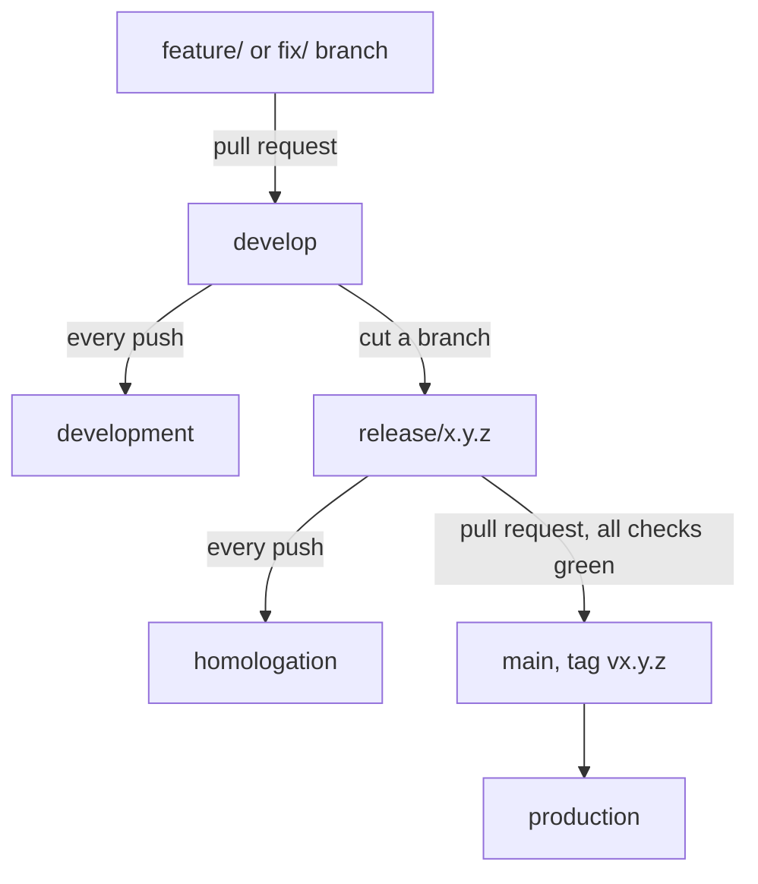

This page is for the person who runs a Fortuna API, or the web UI container,
and has to keep it healthy. It covers what is *operational*: where each
environment runs, what to watch, what is logged, and what is kept. How to get an
instance running the first time, and the meaning of each setting, is on the
[Installation]() page, and this page links to
it instead of repeating it. How the parts fit together is on the
[Architecture]() page.

It is written from the two Operations & Infrastructure Documents
([API](https://github.com/artur-rios/fortuna-api/blob/develop/docs/requirements/Operations%20%26%20Infrastructure%20Document.md),
[UI](https://github.com/artur-rios/fortuna-ui/blob/develop/docs/requirements/Operations%20%26%20Infrastructure%20Document.md)),
the API's `docker-compose.yml` and `Dockerfile`, and the configuration code,
checked on 2026-10-13. Where the document and the code differ, the code wins and
the text says so.

## Environments

The project runs one topology in four environments. What differs between them is
configuration, not shape, which is why the API has one `docker-compose.yml` and
one example environment file per environment
(`docker/<environment>.env.example`) rather than four Compose files.

| Environment | Where | Deployed by | `ASPNETCORE_ENVIRONMENT` | Database |
| --- | --- | --- | --- | --- |
| **Local** | The developer's Windows machine, Docker Desktop | By hand, with `docker compose --env-file docker/local.env up -d --build` | `Development` | `fortuna_local`, on the PostgreSQL installed on the machine |
| **Development** | A Linux VPS, on demand (started only when used) | Jenkins, on every push to `develop` | `Development` | `fortuna_development` |
| **Homologation** | The same VPS, on demand | Jenkins, on every push of a `release/x.y.z` branch | `Production` | `fortuna_homologation` |
| **Production** | The same VPS, always on | Jenkins, on a green `release/x.y.z` to `main` pull request | `Production` | `fortuna` |



- **The three server environments are deployed by
  [yggdrasil](https://github.com/artur-rios/yggdrasil)**, the author's
  deployment platform, whose Jenkins pipeline runs the same `docker-compose.yml`
  with an environment file kept on the server
  (`/etc/yggdrasil/<environment>/fortuna-api.env`, and `fortuna-ui.env` for the
  UI). Each environment is its own Compose project, with its own volumes,
  database and secrets.
- **Development and homologation are on demand.** They are started only while
  used. A merge into `develop` deploys to development if it is running; if it
  is stopped, the build is deployed, checked healthy and stopped again.
  `scripts/ygg.sh env start homologation` (or `development`) on the VPS turns
  one on, and `scripts/ygg.sh env stop homologation` turns it off.
- **Homologation runs as `Production`** on purpose, because any other ASP.NET
  environment serves the OpenAPI UI and detailed errors. Development and the
  local environment run as `Development`, which serves Swagger UI, turns on the
  developer exception page and lets EF log parameter values.
- **Local signs in with the local account.** A local Heimdall is plain HTTP and
  the API refuses a non-HTTPS Heimdall address, so the local example turns on
  `FORTUNA_LOCAL_AUTH_ENABLED`. See the note under
  [Option A: Docker Compose]().
- **Each environment has its own Heimdall.** The API validates tokens from that
  environment's Heimdall, and `FORTUNA_AUTH_TOKEN_SECRET` must equal that
  Heimdall's signing secret. See
  [Connecting to Heimdall]().
- **PostgreSQL is not a service in the Compose file.** Each machine already runs
  an instance shared between services and environments, and each service and
  environment owns its own database. The API container reaches it at
  `host.docker.internal`, and the Compose file maps that name for the Docker
  engine on Linux.
- **The web UI is a static site.** One image per environment, built with the
  API address for that environment compiled in, served by nginx on port `8080`
  behind the proxy. The only difference between the UI's environments is that
  address: no feature is on in one environment and off in another.

{}
The repositories write the servers' public addresses as `example.com`, which
"stands for the real domain" (their own words), and the real domain is recorded
in neither repository. This site therefore names no server address. Wherever you
see `example.com` in the repositories, read it as the address of your own
deployment.
{}

A **desktop offline installation** is another shape rather than another
environment. The app calls the native core in process, so there is no server,
no bound port, no Heimdall and no network to operate. Its state is one SQLite
file; see [Backups and what holds state](#backups-and-what-holds-state).

### How the web UI reaches the API

A deployed web build names its own origin as the API address, and Traefik, the
reverse proxy on the server, routes `<web UI host>/api/` to the API. The browser
therefore makes only same-origin calls, which matters because **the API has no
CORS support**. The API also keeps its own host, which the desktop and Android
builds use. The routing rules and certificates belong to yggdrasil, not to
either repository. The Docker networks (`172.16.0.0/12`) are the trusted proxies
on the server.

## Configuration

Every API setting is an environment variable. Nothing is read from a file baked
into the image (IR-09), and a missing or malformed required value stops the API
at start with every problem listed, rather than failing later (IR-08). The full
list of variables, which ones are required, and what each means is under
[Configuration]() on the
Installation page. What belongs here is how to treat them in operation.

- **Secrets.** The signing secret (`FORTUNA_AUTH_TOKEN_SECRET`, and
  `FORTUNA_AUTH_TOKEN_SECRET_PREVIOUS` during a rotation), the PostgreSQL
  credentials, the Heimdall caller key (`FORTUNA_HEIMDALL_CALLER_KEY`), the Pluggy
  client secret (`FORTUNA_PLUGGY_CLIENT_SECRET`) and the S3 access and secret keys
  (`FORTUNA_STORAGE_S3_ACCESS_KEY`, `FORTUNA_STORAGE_S3_SECRET_KEY`) are secrets.
  No secret appears in the repository or in a log line. The `docker/*.env.example`
  files carry only empty or placeholder values.
- **Rotating the signing secret.** Set the new value in
  `FORTUNA_AUTH_TOKEN_SECRET` and the retired one in
  `FORTUNA_AUTH_TOKEN_SECRET_PREVIOUS`, so tokens signed with the old key keep
  working until they expire. Heimdall signs with the same secret, so the two
  change together.
- **The token lifetime bounds revocation.** `FORTUNA_AUTH_TOKEN_EXPIRATION_IN_SECONDS`
  (default 3600) is the window in which a token revoked at Heimdall is still
  accepted by Fortuna, because Fortuna validates tokens locally without asking
  Heimdall.
- **Settings are read once, at start.** Change the environment file, then
  restart the API.
- **Two names in the document that the API does not read.** The API's Operations
  & Infrastructure Document still lists `FORTUNA_CORS_ALLOWED_ORIGINS` and
  `FORTUNA_LOG_LEVEL`. `FortunaOptions.cs` reads neither and the Compose file does
  not forward them, so setting them changes nothing. There is no CORS support.
  Log levels are set through the standard `Serilog` configuration section instead
  (see [Logging](#logging)).
- **Compose-only variables** (`API_IMAGE`, `API_IMAGE_TAG`, `API_PORT` and the
  `DB_*` pieces of the connection string) are on the [Installation]() page too.
- **Migrations.** With `FORTUNA_RUN_MIGRATIONS=true`, the container entrypoint
  applies pending migrations before starting the API; the Compose file defaults
  it to `true`. Set it to `false` when you apply them out of band. The migration
  helper (`scripts/migrations.py`) never prints a connection string that holds a
  password (IR-15).

The web UI has no run-time configuration. Its address and its optional Google
client identifier are build-time settings (`--dart-define`, or Docker build
arguments for the container), documented under
[Build-time settings]() and
[Web container image]().
They are public by nature, and no secret is ever compiled in: anything in a
Flutter build can be read by whoever receives it.

### Reverse proxy and client addresses

Behind a reverse proxy every connection comes from the proxy, and the caller's
own address travels in `X-Forwarded-For`. The API applies forwarded headers
first in its pipeline, and only from the networks and addresses you list in
`FORTUNA_FORWARDED_KNOWN_NETWORKS` and `FORTUNA_FORWARDED_KNOWN_PROXIES`
(comma-separated CIDR networks and IP addresses; loopback is always trusted).
This decides the address that the logs record and that the per-client rate
limiter uses.

| Proxy configuration | Address logged and rate-limited |
| --- | --- |
| The proxy is listed | The caller's: the rightmost `X-Forwarded-For` entry, the one hop the proxy vouches for. An earlier entry a caller forged is ignored. |
| The proxy is not listed | The proxy's, which identifies nobody, so every caller shares one rate-limit partition. |
| A connection from outside the listed ranges sends `X-Forwarded-For` | The connection's own address. The header is ignored. |

Never list a range a caller can originate from: anything trusted here can claim
any address it likes. Set the proxy's network in production, or every caller is
the proxy.

**Heimdall's anonymous budget is shared by every user of the instance.**
Fortuna's own limiter allows ten requests per minute per source address, and
Heimdall partitions its anonymous authentication limit by connection address.
For every Fortuna user that connection is the API's, so all of an instance's
anonymous authentication calls (sign-in, Google, recovery, reset, verify-email,
two-factor and register) share one Heimdall budget of ten per minute. Once it
is spent, Heimdall answers `429` and users see "Too many attempts. Wait a minute
and try again."

To end the sharing, set `FORTUNA_HEIMDALL_CALLER_KEY` to one of Heimdall's
`HEIMDALL_TRUSTED_CALLER_KEYS`. Every request the API makes to Heimdall on behalf
of a user then carries the key in `X-Heimdall-Caller-Key` and the user's address
in `X-Heimdall-Client-Address`, and Heimdall counts the request in that address's
own partition (IPv6 by /64). The address is the one Fortuna itself logs and
limits by, so list the proxy as above, or it is the proxy's address. The key
must be at least 32 visible ASCII characters with no spaces, and startup rejects
any other, naming the variable and never its value. A request with no client
address, such as one made outside a user's request, is sent without either
header. For the rate limits themselves, see
[Rate limiting]() in the API reference.

## Health checks

| Check | Where | Who may call it |
| --- | --- | --- |
| Liveness | `GET /healthcheck` | Anyone. |
| Detailed health | `GET /healthcheck/detailed` | An instance (system) administrator only. |
| Container health check | The Compose file calls `/healthcheck` every 15 seconds (5 second timeout, 5 retries, 30 second start period) | The container runtime. |
| Web UI container | `GET /healthz` answers `ok` | Anyone. The nginx image serves it and does not log it. |

**Liveness** returns exactly the service name and the published contract
version, and it never touches a dependency. A `200` means only that the process
is answering. It exposes no build version and no operational detail
(FR-HC-12).

```json
{"contractVersion":"v1","service":"Fortuna API"}
```

**Detailed health** checks each dependency and reports it individually. The
response contains no configuration value, no connection string and no credential
(FR-HC-11).

```json
{
  "status": "Healthy",
  "services": [
    { "name": "Database", "status": "Healthy" },
    { "name": "AttachmentStorage", "status": "Healthy" },
    { "name": "JobRunner", "status": "Healthy", "queueDepth": 0, "oldestPendingSeconds": 0 },
    { "name": "Aggregator", "status": "Degraded" },
    { "name": "ExchangeRateSource", "status": "Healthy" }
  ]
}
```

| Aggregate | When | HTTP status |
| --- | --- | --- |
| `Healthy` | Every verified dependency is up. | `200` |
| `Degraded` | Only an optional external service is down: the aggregator (Pluggy) or the exchange-rate source. Neither is needed to serve a user's own data. | `200` |
| `Unhealthy` | A required dependency is down: the database, the attachment storage or the job runner. | `503` |

The job runner is reported unhealthy when the oldest pending job is older than
`FORTUNA_HEALTH_JOB_MAX_PENDING_SECONDS` (default `300`), because jobs are being
accepted but not progressing. An external service that is not configured in this
deployment is reported as not configured and does not affect the aggregate.

An administrator reads the same information in the interface on the health
screen, described under
[Settings, two-factor and instance health]().
The native core has its own health function, `fortuna_health`, for desktop
offline mode.

### UC-75: Check API Health

UC-75 is the one use case in the Operations & Infrastructure Document. Its
actors are a monitoring system or an anonymous caller (liveness) and the
instance administrator (detailed). It changes no state. Its alternative flows:

| ID | Condition | Outcome |
| --- | --- | --- |
| AF-01 | The detailed check is requested by a caller who is not an instance administrator. | `403 Forbidden`. |
| AF-02 | The detailed check is requested with no or an invalid token. | `401 Unauthorized`. |
| AF-03 | The database is unreachable. | `503` with the aggregate `Unhealthy` and the database marked down. |
| AF-04 | Only the aggregator or the rate source is unreachable. | `200` with the aggregate `Degraded`. A user's own data is still served. |
| AF-05 | An external service is not configured in this deployment. | It is reported as not configured and does not affect the aggregate. |
| AF-06 | The oldest pending job exceeds the configured age threshold. | The job runner is reported `Unhealthy`. |
| AF-07 | A liveness caller ignores the response body. | It stays compatible: `200 OK` still means the process is up. |
| AF-08 | Dependencies are starting or not ready. | Liveness still returns its two published identifiers. Dependency readiness is detailed-only. |

UC-75 is defined in section 5.4 of the API's Operations & Infrastructure
Document, which numbers it to continue the Use Case Specification Document
rather than restarting. Its requirements are FR-HC-01 to FR-HC-11.

## Logging

The API writes **structured JSON** through Serilog, to the console and to a file
rolled daily under `FORTUNA_LOG_DIRECTORY/<yyyy>/<MM>/` as
`fortuna-<yyyyMMdd>.json`. In a container the log directory is a named volume.

- **Correlation.** Every request carries its W3C trace id, returned in the
  `traceparent` response header and propagated into any job the request starts,
  so a job's log lines can be traced back to the request that queued it.
- **Request start.** Every API request logs
  `Started request with TraceId {TraceId} from {ClientIp}`, before request
  logging, rate limiting and authentication run, so the source of a
  credential-stuffing run can be found afterwards.
- **Levels.** The minimum level is `Information`. Framework namespaces
  (`Microsoft`, `Microsoft.EntityFrameworkCore`, `System.Net.Http.HttpClient`) are
  held at `Warning`, because their `Information` events are per-request noise
  the request logging already summarizes. The exception is
  `Microsoft.Hosting.Lifetime`, which stays at `Information` so that start-up and
  shutdown are logged (`FortunaLogging.cs`). Any level can be changed through the
  standard `Serilog` configuration section, for example the environment variable
  `Serilog__MinimumLevel__Override__Microsoft.EntityFrameworkCore=Information`.
  There is no `FORTUNA_LOG_LEVEL`.
- **Jobs** log their acceptance, start, per-outcome counts and completion, never
  the content of a row they processed.
- **Never logged:** a monetary amount; an account, card or investment identifier
  or name; a token, a signing key, an aggregator secret, an access token, a
  recovery code or its hash; attachment content; the contents of an imported
  file; a connection string with its password. A support engineer can tell
  *that* an import processed 412 rows and rejected 3, and *why* those 3 were
  rejected, without learning what anybody spent.
- **The client address is personal data.** It is the one identifying value the
  logs carry on purpose, and under the GDPR and the LGPD an IP address is
  personal data. It is written to the console and the JSON files and kept for as
  long as those files are. It is never written to the database, an audit entry or
  an export. **Whole-account erasure does not rewrite the log files**, so your
  log rotation is what bounds the retention.
- **Fortuna deletes no log file itself.** How long one is kept is the operator's
  rotation.

The **web UI logs nothing in a release build**. In debug builds it uses Dart's
`developer.log` to the developer console only. It has no crash reporting and no
analytics, deliberately: people self-host Fortuna so that nobody else sees their
financial history. The cost, which the UI's document accepts, is that a crash on
a user's machine produces no report.

## Metrics

The API publishes OpenTelemetry metrics in the Prometheus text format, under
the service name `fortuna-api`: ASP.NET Core request and outbound `HttpClient`
instrumentation, plus the `System.Runtime`, `Microsoft.AspNetCore.Server.Kestrel`,
`Microsoft.EntityFrameworkCore` and `Npgsql` meters. The native core exposes no
metrics, and the web UI serves none.

- **A private listener.** The container listens on two ports: `8080` for the API
  and `FORTUNA_METRICS_PORT` (default `9464`) for metrics. The container
  entrypoint derives `ASPNETCORE_HTTP_PORTS` from that setting (`8080;9464`, or
  just `8080` when the exporter is off) and refuses to start when the metrics
  port equals the API port. An explicit `ASPNETCORE_HTTP_PORTS` takes precedence.
- **Never on the public port.** A request is served as a scrape only when its
  path is `/metrics` **and** the connection's local port equals
  `FORTUNA_METRICS_PORT` (IR-27). The `Host` header plays no part, because the
  proxy forwards the caller's. On `8080`, `/metrics` is an unknown path like
  any other. The private port answers `404` to every other path.
- **Not published to the host.** The reverse proxy routes only `8080`;
  Prometheus scrapes `http://<container>:9464/metrics` over the private Docker
  network, and the Compose file never publishes `9464`.
- **No token, no log line.** The exporter runs before request logging, rate
  limiting and authentication, so a scrape needs no token and is not logged. It
  is middleware rather than a controller, so it is absent from the OpenAPI
  document.
- **`FORTUNA_METRICS_PORT=0`** removes the exporter and its instrumentation
  entirely. Outside a container, the metrics port must also be one that Kestrel
  listens on (`ASPNETCORE_HTTP_PORTS`), so `0` is simplest.

A Prometheus scrape configuration for it:

```yaml
scrape_configs:
  - job_name: fortuna-api
    static_configs:
      - targets: ["fortuna-api:9464"]
```

On the project's servers, Prometheus scraping and the console are provided by
yggdrasil. The UI's document names Prometheus and Loki as the server-side
observability stack, which runs against the API and its host, not against the UI.

## Backups and what holds state

**Neither repository documents a backup or restore procedure**, and this page
does not invent one. What it can say is where state lives, so you know what to
back up.

| Thing | Where it lives | Notes |
| --- | --- | --- |
| Financial data | The PostgreSQL database (schema `fortuna`), or for the API on SQLite, one database file | PostgreSQL is outside the Compose file, so its backup is yours. The API's Compose file does not manage the database. |
| Attachments | A named Docker volume (`attachments`, mounted at `/app/attachments`) with the `Filesystem` provider, or an S3-compatible bucket with `S3` | Chosen by `FORTUNA_STORAGE_PROVIDER`. |
| Logs | A named Docker volume (`logs`, mounted at `/app/logs`) | See [Logging](#logging) for retention. |
| Produced export files | Not stated in the operations documents | `FORTUNA_EXPORT_RETENTION_HOURS` (default 24) bounds how long a produced file is kept. |
| Jobs | A durable job table in the database | The job runner re-queues every job left `Pending` or `Running` when the process starts, and re-running a job imports no duplicate (IR-11). |
| Desktop offline data | One SQLite file at the path given by `FORTUNA_DB_PATH` | The native core's schema is separate from the API's SQLite schema, and the two are not interchangeable files. A forgotten local-account secret with no recovery codes loses the account. See [Offline mode](). |

The repositories describe no procedure for undoing applied migrations. What they
do describe is the release rollback: if a production deploy fails, Jenkins rolls
back to the previous image and leaves the pull request open, and the fix goes on
`develop` in a new release.

A user can take a complete copy of their own personal data through the
personal-data export, which is a data right and not an operator backup; see
[Privacy and data rights]().

## Build and delivery

**The image.** A multi-stage `Dockerfile` restores from an explicit list of
project files, builds in Release and publishes. It carries no environment file
and no secret, and its entrypoint applies pending migrations when
`FORTUNA_RUN_MIGRATIONS` is `true`, then starts the API. The image is not pushed
to any public registry; see
[Getting a release]().

**Continuous integration** runs on every pull request into, and every commit to,
`develop` and `main`. The workflows that report a required check run with no
path filters, so a change to an unlisted path cannot merge without evidence that
everything still passes.

| Repository | Workflow | What it does |
| --- | --- | --- |
| API | `tests.yml` | Tests the helper scripts, checks for a blank line above every `return`, `break` and `yield`, restores, scans for vulnerable dependencies, builds once in Release, fails any test with no category, runs the unit suite, then the functional suite on a Testcontainers PostgreSQL, fails below the coverage floor, uploads the report, and builds the container image in a separate job. |
| API | `check-openapi.yml` | Regenerates the OpenAPI document from the code and fails if the committed one differs (IR-14). |
| API | `native-core.yml` | Tests on the declared minimum Rust version, then format-checks, lints and tests the native core on Windows and Linux, builds each release library, rejects generated-header drift and uploads the library and header as artifacts. It runs only when the native core or the OpenAPI document changes. |
| API | `audit.yml` | Checks the native core's Cargo dependencies against the RustSec advisory database on every pull request. |
| API | `branch-policy.yml` | Enforces the branching model on pull requests into `develop` and `main`. |
| UI | `ci.yml` | Verifies formatting, runs `flutter analyze`, the boundary rules and `flutter test --coverage`. The gate for merging. |
| UI | `check-generated.yml` | Regenerates the API client and the FFI bindings, diffs the vendored header against the API's published one, and fails on any difference. |
| UI | `branch-policy.yml` | Enforces the branching model. |
| UI | `build.yml` | On a `v*` tag and on demand, builds the four targets and keeps the outputs as workflow artifacts. |

What those artifacts are, and that no installer or package is published yet, is
under [What CI keeps](). The
branching model and the release steps are on the
[Development]() page.

## Platform requirements

Each repository's Operations & Infrastructure Document gives its platform
requirements an identifier space of their own, `IR-xx`, so they never collide
with the domain's `FR-` numbers. The two lists are independent: IR-01 of the API
is not IR-01 of the UI. One line each, paraphrased; the documents have the exact
wording.
The API's README still says the platform requirements run from `IR-01` to
`IR-20`. The document defines 27, and the table below follows the document.

### API: IR-01 to IR-27

| ID | Requirement |
| --- | --- |
| IR-01 | Layers `Domain`, `Application` (`Command` / `Query` / `Shared`), `Infrastructure` (`Data` / `Integration`) and `Presentation` (`WebApi`), with `Integration` holding no reference to `Data`. |
| IR-02 | Package versions managed centrally in `Directory.Packages.props`, with transitive pinning. |
| IR-03 | Entity Framework Core code-first, with a design-time factory and an initial migration. |
| IR-04 | `snake_case`, singular table and column names; EF sensitive-data logging and detailed errors only outside Production. |
| IR-05 | Schema `fortuna`, with the connection's `Search Path` pinned to it. |
| IR-06 | Money is `numeric(19,4)`, exchange rates `numeric(19,8)`, never a floating-point type. |
| IR-07 | The ISO 4217 currency set is seeded on startup, idempotently. |
| IR-08 | All configuration from `FORTUNA_`-prefixed environment variables; refuse to start when a required one is absent. |
| IR-09 | Environment files are copied to the build output and never baked into the image. |
| IR-10 | A background job runner as a hosted service, with a bounded in-process queue and a durable job table. |
| IR-11 | Jobs left `Pending` or `Running` are re-queued at start, and re-running imports no duplicate. |
| IR-12 | Ingestion sources register through one contract in a source registry. |
| IR-13 | Attachment storage behind one abstraction, with a filesystem and an S3-compatible implementation chosen by configuration. |
| IR-14 | A served OpenAPI document, verified against the code in CI. |
| IR-15 | A migration helper script that never prints a connection string holding a password. |
| IR-16 | Test projects mirror `src/` one for one, and the functional harness uses a real PostgreSQL container. |
| IR-17 | CI on every pull request and commit to `develop` and `main`: restore, scan, build, unit, functional, coverage floor, image build. |
| IR-18 | One `docker-compose.yml` for every environment, differing only in the environment file. |
| IR-19 | The container declares a health check against the liveness endpoint. |
| IR-20 | No Heimdall connection on the request path, and a desktop installation runs with no network at all. |
| IR-21 | The native core publishes `fortuna_core.dll` (Windows x64) and `libfortuna_core.so` (Linux x64) with its generated C header. |
| IR-22 | Native initialization takes an explicit database path and configuration; shutdown invalidates all process-local sessions. |
| IR-23 | A native operation called before initialization returns status `503` and a JSON failure envelope rather than crashing. |
| IR-24 | Every native function that returns JSON allocates it natively, documents ownership, and accepts release through `fortuna_string_free`. |
| IR-25 | Native CI builds and tests on Windows and Linux, rejects generated-header drift and publishes both platform artifacts. |
| IR-26 | The native core owns a namespaced SQLite schema independent of EF migrations, with money stored as `TEXT`. |
| IR-27 | Prometheus metrics only on a dedicated private listener, selected by the connection's local port. |

### UI: IR-01 to IR-22

| ID | Requirement |
| --- | --- |
| IR-01 | The repository follows the documented layout, with `test/` mirroring `lib/` exactly. |
| IR-02 | Organized by feature, each owning its data, state, validation and UI, and depending on `core` rather than on another feature. |
| IR-03 | One central route guard that every route passes. |
| IR-04 | One sealed result type that every repository returns, so a failure is a value rather than an exception. |
| IR-05 | One money type carrying an exact decimal and its currency, with no conversion to a floating-point type. |
| IR-06 | Locale-aware formatting for `en-US`, `en-GB`, `en-150` and `pt-BR`, with no hard-coded formatting elsewhere. |
| IR-07 | Secure-storage and preference wrappers; the token is writable only through the secure one. |
| IR-08 | One configured HTTP client carrying the bearer-token interceptor, base address and timeouts. |
| IR-09 | The API client is generated from `api/fortuna.json` by a single command, and committed unmodified. |
| IR-10 | The FFI bindings are generated from `native/include/fortuna_core.h` by a single command, and committed unmodified. |
| IR-11 | The build fails when the vendored C header differs from the one the API publishes. |
| IR-12 | CI regenerates both the client and the bindings and fails on any difference. |
| IR-13 | Static analysis fails the build when `dart:ffi` is imported outside the bindings layer. |
| IR-14 | Static analysis fails the build when a monetary value is converted to or from a floating-point type. |
| IR-15 | Every FFI call goes to a worker isolate, and every string the core returns is released, including on failure paths. |
| IR-16 | Configuration is supplied at build time by `--dart-define`, with no secret compiled into the artifact. |
| IR-17 | No log from a release build, and no log ever carries a credential, token, personal data or financial figure. |
| IR-18 | No analytics, telemetry, crash reporting or other third-party component that observes use. |
| IR-19 | CI runs `flutter analyze` and `flutter test` on every pull request and push to `develop` and `main`, and fails on either. |
| IR-20 | CI builds every target (web, Windows, Linux, Android) and publishes the artifacts. |
| IR-21 | Desktop packages include the application, the core library and the SQLite database file, and work with nothing else installed. |
| IR-22 | The web image serves the built application as static files and carries no application secret. |

IR-21 describes the intended desktop packages. The UI's `build.yml` does not
build them yet, as the
[Installation]() page
explains.
