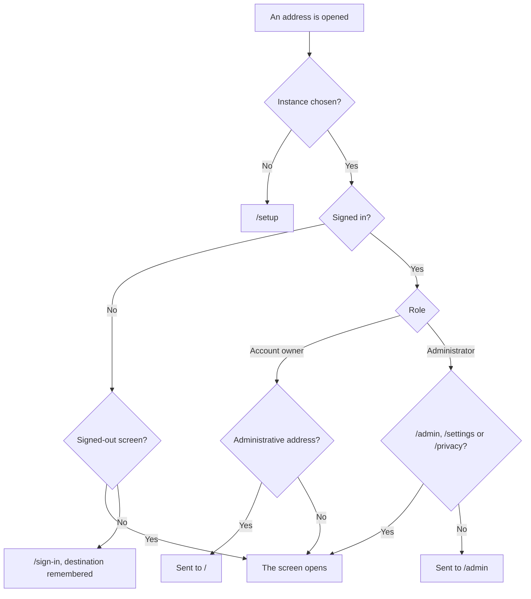

This guide describes the Fortuna interface (Fortuna UI) screen by screen. It is
organized by the interface's use cases, the numbered `UC-xx` items in the
[Use Case Specification](https://github.com/artur-rios/fortuna-ui/blob/develop/docs/requirements/Use%20Case%20Specification%20Document.md).
Every use case appears exactly once, under the heading "UC-xx: name", on the
page for its area. Button names, dialog titles and messages are quoted from the
application's code, not from the specification, so they are what you will see.

Where the specification and the code disagree, this guide describes what the code
does. Where a screen is not built yet, the guide says so in plain words instead
of describing it as if it worked. For the rules behind the screens (what a
transfer is, how installments are split, what consent covers) see
[Concepts](). For how the interface reaches the
API or the native core, see [Architecture]().

## There is no menu

**The interface has no navigation menu and no home dashboard.** This is how the
code stands, not a design choice the guide is working around.

- The home screen, at the address `/`, is a placeholder. It shows a screen
  titled "Overview" with the text "/ is routed and guarded. Its screen is
  UC-38." and a sign-out button. The net position, projections and obligations
  that UC-38 describes live on their own screen, covered in
  [Projections]().
- The code contains no navigation rail, drawer or bar. Screens link to a few of
  their neighbours: the transactions grid opens a transaction and the record
  form, a credit card opens its statements, an import job opens its records, and
  the "set up X first" notices link to accounts, cards or categories.
- Most screens have no link pointing to them from any other screen. On the web
  you open them by typing their address after the instance's address. The code
  contains no control that opens them on Windows, Linux or Android. This is a
  gap in the application as built.

Each page in this guide therefore names the **address** of every screen it
describes, for example `/accounts`. Treat the address as the screen's name.

## Who can reach what

One guard decides this for every address, however it was reached: a typed web
address, a link, or a session restored at start (UC-46 below). Hiding a control
is never the protection: the guard and the API both refuse.

| Address | Signed out | Account owner (and the desktop offline user) | Instance administrator |
| --- | --- | --- | --- |
| `/setup`, `/sign-in`, `/sign-up`, `/sign-in/two-factor`, `/password-recovery`, `/password-reset`, `/verify-email` | Yes | Redirected away | Redirected away |
| `/settings`, `/privacy` | Sent to sign in | Yes | Yes |
| `/admin` | Sent to sign in | Redirected to `/` | Yes |
| Every other address in this guide | Sent to sign in | Yes | Redirected to `/admin` |

This table was checked against the application's
[route table](https://github.com/artur-rios/fortuna-ui/blob/develop/lib/app/routes.dart)
and
[route guard](https://github.com/artur-rios/fortuna-ui/blob/develop/lib/app/route_guard.dart).
The details:

- Until an instance address has been chosen, every address sends you to
  `/setup`, even the sign-in screen.
- A signed-out request for a protected address goes to `/sign-in`, and the
  address you wanted is remembered. After you sign in you are taken there if
  your role may reach it.
- A pending two-factor challenge counts as signed out.
- A signed-in user who opens one of the signed-out screens is sent to the
  remembered destination if there is one, and otherwise home: `/` for an account
  owner, `/admin` for an administrator.
- An address that matches no screen shows "No screen at" followed by the address,
  with a "Go to the overview" button. This applies to account owners; a signed-in
  administrator is redirected to `/admin` instead, and a signed-out user to
  sign-in.
- `/settings` and `/privacy` are the two screens both roles share. An
  administrator has no way into any financial screen.

## UC-46: Guard a Route by Session and Role

This is a mechanism, not a screen: it is the guard described above. Its main
flow is that a route is requested, the single central guard checks it against
the current session and role, and either the screen opens or the guard
redirects. Its alternatives, as built:

- An account owner who asks for `/admin` is sent to `/` and is not told the
  address exists.
- A request with no session goes to sign-in with the destination remembered.
- A pending two-factor challenge is treated as no session.
- The guard re-evaluates on every navigation, not only at sign-in, so a change of
  role takes effect on the next move.
- Manipulating the client to reveal a hidden control achieves nothing, because
  the guard and the API refuse the action independently.

## Pages in this guide

| Page | What it covers | Use cases |
| --- | --- | --- |
| [Signing in]() | Choosing an instance, signing in and out, Google, sign-up, password recovery, restoring a session. | UC-01, 03, 04, 05, 09, 11, 12, 47 |
| [Settings, two-factor and instance health]() | Theme, locale and display currency, two-factor management, the administrator's health screen. | UC-10, 13, 45 |
| [Accounts, cards and investments]() | Financial accounts, credit cards and their statements, investments and their movements and valuations. | UC-14 to 18 |
| [Transactions and transfers]() | Recording, correcting and deleting transactions, transfers, reconciliation, attachments. | UC-19, 20, 21, 24, 35 |
| [Installments and recurring commitments]() | Installment purchases, and the recurring commitments screen that does not exist yet. | UC-22, 23 |
| [Spreadsheet]() | The filterable, sortable, paged transactions grid. | UC-25 |
| [Categories, tags, budgets and goals]() | The category tree, tags and counterparties, budgets, goals. | UC-26 to 29 |
| [Imports and connections]() | Data sources, connecting an institution, importing a file, following a job, reviewing imported records. | UC-30 to 34 |
| [Charts]() | Aggregations drawn as charts, and drilling down to transactions. | UC-36, 37 |
| [Projections]() | Net position, projected balance, committed obligations. | UC-38 |
| [Exports]() | Exporting the transactions view as CSV, Excel or PDF. | UC-39 |
| [Deleted records and the audit trail]() | Restoring or permanently removing deleted records, reading the audit trail. | UC-40, 41 |
| [Privacy and data rights]() | Consents, the complete personal-data export, erasing the account. | UC-42, 43, 44 |
| [Offline mode]() | What works without a network, what shows "Not available offline" and why, the desktop local account, and how the interface reaches the core. | UC-02, 06, 07, 08 |

The 47 use cases are all placed: 46 on the pages above and UC-46 on this page.

## What is not built or not released

The UI README names UC-04, UC-23 and UC-35 as the use cases that remain, and
GitHub agrees: their issues are open. Reading the code turned up more. This table
is the whole list, and each item is explained on the page named.

| Item | State | Page |
| --- | --- | --- |
| UC-04, completing a two-factor challenge at sign-in | Unfinished. The route shows a placeholder. Issue [#5](https://github.com/artur-rios/fortuna-ui/issues/5). | [Signing in]() |
| UC-23, managing recurring commitments | No screen and no route. Issue [#24](https://github.com/artur-rios/fortuna-ui/issues/24). | [Installments and recurring commitments]() |
| UC-35, managing a transaction's attachments | No screen. Issue [#36](https://github.com/artur-rios/fortuna-ui/issues/36). | [Transactions and transfers]() |
| UC-47, signing up | On the `develop` branch, not in the v1.0.0 release. | [Signing in]() |
| UC-10, managing two-factor, and UC-06, 07 and 08, the desktop local account | The screens are written and tested, but no route opens them and no screen links to them. | [Settings](), [Offline mode]() |
| UC-32, importing a file | The screen asks for the file only. The API also requires a target and, for a workbook, a column mapping. | [Imports and connections]() |
| The home screen | A placeholder. | This page |
| A navigation menu | Does not exist. | This page |

## Sources

This guide is written from the interface's
[Use Case Specification](https://github.com/artur-rios/fortuna-ui/blob/develop/docs/requirements/Use%20Case%20Specification%20Document.md)
and its code on the `develop` branch (the
[route table](https://github.com/artur-rios/fortuna-ui/blob/develop/lib/app/routes.dart),
the [router](https://github.com/artur-rios/fortuna-ui/blob/develop/lib/app/router.dart)
and the feature folders under
[`lib/features`](https://github.com/artur-rios/fortuna-ui/tree/develop/lib/features)),
checked on 2026-10-13. The code wins where the two differ.
