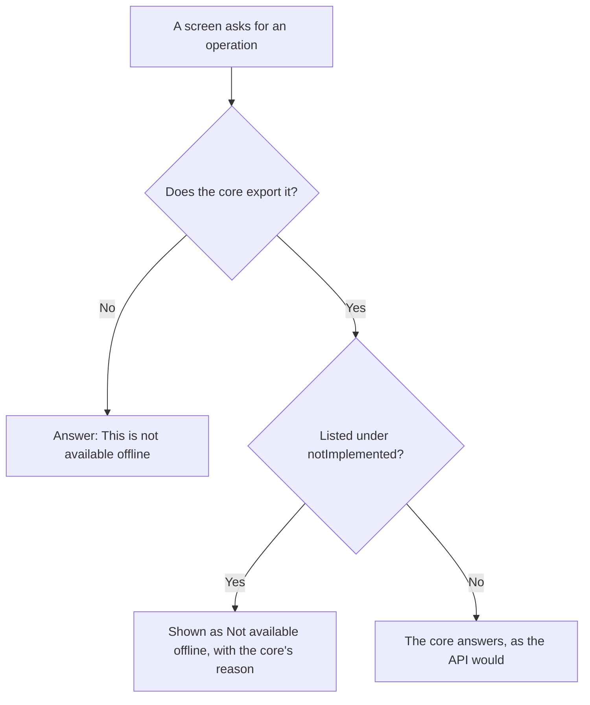

Desktop offline mode runs the Fortuna core inside the application, on your own
machine, with no network and no server. Your data stays in a file on that computer.
It is available only on Windows and Linux, and only when the core library loads. How
it is built is on the [Architecture]()
page, and how to build and start it is in
[Installation](). You
get into it in one of two ways: a build made for it starts there directly, and an
ordinary desktop build with a loadable core offers **Use this device only** on the
setup screen (see
[Signing in]()).

The core is a work in progress. It does not implement everything the API does yet, so
some screens say so instead of working. The complete, reasoned list is on the
Architecture page under
[What offline mode does not support yet]();
this page shows where each item appears in the interface.

| Address | Screen |
| --- | --- |
| `/setup` | Set up your instance: offers "Use this device only" on a desktop build that did not start offline; a build made for offline mode never shows it |
| Local-account screens | None: no route opens them (see UC-06 to UC-08 below) |

## What works

Everything the core implements works as it does online, with no change to the
screens. By reading the lists of what the core does not implement and does not export
(see Architecture), these work offline:

- financial accounts, credit cards (but not their statements), investments with
  their movements and valuations;
- recording, editing and deleting transactions, and the
  [Spreadsheet]();
- categories, tags and counterparties, and the lists of budgets and goals (without
  their spent and progress figures);
- deleted records, the audit trail and settings;
- the complete personal-data archive, which the core builds itself, and erasing the
  account (see [Privacy and data rights]()).

## What shows "Not available offline"

The application reads the core's list of unimplemented operations **once**, when
offline mode starts. Each entry point that depends on one is then shown as **Not
available offline** with the core's own reason, before you fill in anything that
would have been refused. There is no retry: it would be refused the same way each
time. Over HTTP none of this applies.

| Where you see it | Screen | Why, in a few words |
| --- | --- | --- |
| The whole screen is replaced | Import a file, `/imports/new` | No workbook or PDF parser exists natively. |
| A line on a failed job | Imports, `/imports` ("Retry this import") | Same as file imports. |
| The **Export** icon is disabled, with a tooltip | Transactions, `/transactions` | No data-set export renderer exists natively. |
| The whole screen is replaced | Insight, `/insight` | Reports are not computed natively. |
| The whole screen is replaced | Projections, `/insight/projections` | Reports and projections are not computed natively. |
| The whole screen is replaced | Record a transfer, `/transfers/new` | Paired legs, conversion and the lifecycle cascade are not implemented. |
| The whole screen is replaced | Record an installment purchase, `/installments/new` | Splitting a purchase across billing cycles is not implemented. |
| The **Statements** button is disabled; both statement screens are replaced; a line replaces **Close** and **Settle** | Credit cards, `/credit-cards`, and statements | Charges are not assigned to billing cycles natively. |
| A line on each budget card | Budgets, `/budgets` | Consumption is not computed natively. |
| A line on each goal card | Goals, `/goals` | Progress is not computed natively. |
| A line on the transaction | Transaction, `/transactions/:id` | Reconciliation needs imported records, which the core does not create. |

Each of those screens is described, with its offline behavior, on its own page.

## Not offered at all

Some routes are not exported by the core, because they depend on the network or on a
host: connected identity, Pluggy connections and data sources, remote exchange-rate
synchronization, hosted consent, the HTTP health routes and administrator erasure of a
user. The interface cannot call them. For a route the core does not export, the
application's offline adapter answers with its own message,
"This is not available offline:" followed by the method and the path, and the
interface treats it like any other "not available offline" answer. That is why
connections, the data sources list, sign-up, password recovery and the consent list
cannot work in this mode. The full list is in the
[native core README](https://github.com/artur-rios/fortuna-api/blob/develop/native/README.md).

## UC-02: Reach the Fortuna Core Over the Configured Transport

This is a mechanism, not a screen. It is how every other screen gets its data without
knowing whether it is talking to the API or to the core.

1. A screen asks its repository for an operation.
2. The repository's implementation for the transport the application was built with
   carries it: over HTTP to the API, or, with `FORTUNA_TRANSPORT_FFI` set at build
   time, across the foreign-function boundary into the core. The data is the same JSON
   either way.
3. A call into the core runs on a worker, so the screen never freezes.
4. Money stays an exact decimal, and is never read through a floating-point number.
5. The transport returns a result value, not an exception, so a failure is something
   the screen can show. It reports a write as successful only when the response
   confirmed it.

Notable alternatives:

- **The API refuses an operation,** or the core does. The reason is shown unaltered,
  and the interface's own expectation never overrides it.
- **The core exports an operation but does not implement it.** The core answers `501`
  (`FORTUNA_STATUS_NOT_IMPLEMENTED`). The screen shows the core's reason and offers no
  retry. The core lists every such operation under `notImplemented` in
  `fortuna_capabilities`, which is how the entry points above are marked before you
  reach them.
- **A response with a field the application does not know** is ignored, not a crash.
- **A core with an older contract** that does not publish `notImplemented` still
  works: its features are offered as before, and a `501` is handled where it arrives.
- **The vendored header or the generated client drifts** from the API's. That fails
  the build or CI, so it is never discovered at run time.

## UC-06: Create a Desktop Local Account

**Not reachable.** The three local-account screens (UC-06, UC-07 and UC-08) are
written and have tests, and the UI README marks all three done. But the application's
router has no route for any of them and no screen links to them. The sign-in screen
that offline mode shows is the ordinary email-and-password form, with the sign-up link
hidden. By reading the code, submitting it offline gets "This is not available
offline: POST /api/auth/login.", because the core does not export Heimdall sign-in.
So in this version a person cannot create or use a local account from the interface.
The intended flow, which the screens implement, is described here and on the
Architecture page under
[Offline: the local account]().

The screen is titled "Create a local account" and says "This account exists only on
this computer. Nothing is sent anywhere."

1. Enter a **Name** and a **Secret** and press **Create account**.
2. The core creates the account.
3. The screen "Keep these recovery codes" shows the recovery codes **once**: "These are
   shown once and cannot be retrieved again. If you forget your secret and have lost
   every one of these codes, this account and everything in it is gone." A **Copy**
   button copies them.
4. Tick "I have saved these codes somewhere safe" and press **Continue to sign in**.

Trying to leave before ticking the box asks "Leave without keeping your codes?" and says
"Your recovery codes will not be shown again. Without them, a forgotten secret means
losing this account and everything in it.", with **Go back** and **Leave anyway**. If an
account already exists, creation is not offered and sign-in is shown instead.

## UC-07: Sign In to a Desktop Local Account

**Not reachable**, as above.

The screen is titled "Sign in" and says "This installation works offline. Your data
never leaves this computer."

1. Enter the **Account name** and the **Secret** and press **Sign in**. No
   identity-provider path is offered.
2. The core authenticates you, and the session always carries the account owner role.
3. You go to the overview, which is the placeholder at `/`.

Alternatives: an unknown name and a wrong secret get the same message from the core, so
the screen does not reveal which accounts exist. With no local account, the screen says
"This installation has no local account yet. Create one to begin." with **Create a
local account**. **Forgotten your secret?** opens "There is no password reset here",
which explains that resetting a password needs another channel to prove who you are, such
as an email, and an account that exists only on this computer has none, so "Your recovery
codes are that proof instead." Choose **Use a recovery code** or **Close**. The rule
behind this is [API-BR-36](https://github.com/artur-rios/fortuna-api/blob/develop/docs/initial/Business%20Rules.md).

## UC-08: Recover a Desktop Local Account

**Not reachable**, as above.

The screen is titled "Recover your account".

1. It says "Use one of the recovery codes you saved when this account was created. It
   will be used up." Enter the **Account name**, one **Recovery code** and a **New
   secret**, and press **Recover account**.
2. The core accepts the code and marks it spent. The screen "You are back in" says
   "That code is now used up. You have N codes left." If it was the last one, it says
   "That code is now used up, and it was your last one. If you forget this secret there
   is no way back into this account."
3. Choose **Issue a new set of codes**, which shows "Your new recovery codes" once, with a
   warning that "These replace every code you had before." Or choose **Keep the codes I
   have**.

Alternatives: a wrong or already-spent code gets one message from the core, the same as
an unknown account. If issuing new codes fails, the screen says "Nothing changed — your
existing N codes are still valid." and offers **Try again** or **Continue without new
codes**.

## Sources

This page is written from the interface's
[Use Case Specification](https://github.com/artur-rios/fortuna-ui/blob/develop/docs/requirements/Use%20Case%20Specification%20Document.md)
(UC-02, UC-06, UC-07, UC-08) and its
[changelog](https://github.com/artur-rios/fortuna-ui/blob/develop/CHANGELOG.md),
checked against the code in
[`offline_capabilities.dart`](https://github.com/artur-rios/fortuna-ui/blob/develop/lib/core/network/offline_capabilities.dart),
[`ffi_transport.dart`](https://github.com/artur-rios/fortuna-ui/blob/develop/lib/core/network/ffi_transport.dart),
[`lib/features/auth`](https://github.com/artur-rios/fortuna-ui/tree/develop/lib/features/auth)
and the [router](https://github.com/artur-rios/fortuna-ui/blob/develop/lib/app/router.dart),
and against the API's
[native core README](https://github.com/artur-rios/fortuna-api/blob/develop/native/README.md).
